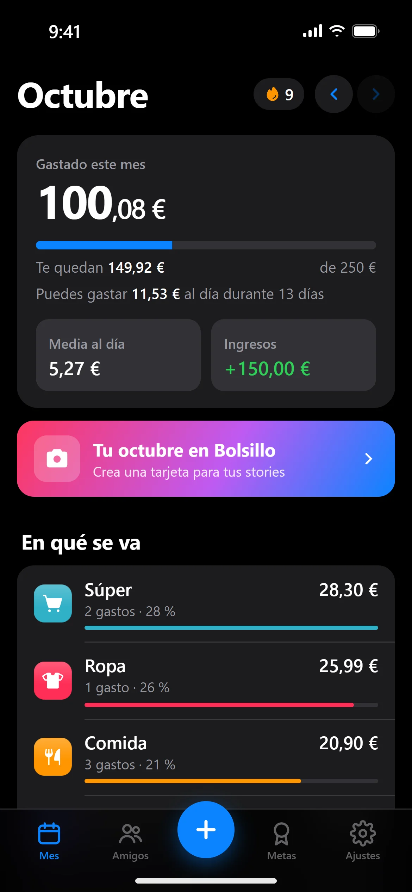

# Bolsillo

¡Qué mejor descripción de Bolsillo que la de un joven que no llega a final de mes y no sabe en qué se le ha ido el dinero! Pienso que nos pasa a todos. Por eso creé esta app: para todos, para nosotros, los jóvenes.

**Pruébala:** [bolsillo-app-9tz.pages.dev](https://bolsillo-app-9tz.pages.dev/conoce/)

## Por qué la hice

Básicamente creé esta app para poder ahorrar, ver en qué se me va cada gasto y llevar el control absoluto de mi dinero. Después se la enseñé a mis amigos, que están igual que yo o que se gastan el dinero y no saben en qué.

## Qué hace

- **Apuntar en un toque**, con categorías y presupuesto al mes o de paga a paga
- **Pago automático**: con Apple Pay o Google Wallet (beta), el gasto se apunta solo
- **Duelos**: retas a tus amigos a ver quién gasta menos
- **Grupos**: las cuentas del piso o de un viaje, con enlaces de cobro por Bizum
- **Modo tóxico**: tus amigos de confianza ven en qué gastas (y reaccionan)
- **¿Me lo puedo permitir?** y límites por categoría
- Sin registro ni email, y sin acceso a tu banco

## Tecnologías

- HTML, CSS y JavaScript sin frameworks
- App instalable (PWA) que funciona sin conexión, con service worker
- Cloudflare Pages Functions para la API y Cloudflare D1 (SQLite) como base de datos
- Avisos push (Web Push) y un Worker programado para los recordatorios

## Cómo la he hecho

Al principio pensé en hacerla con tutoriales, aprendiendo el lenguaje paso a paso, que es como se suele aprender. Pero no todo es sota, caballo y rey: a veces también hay que desviarse de ese camino tan convencional, que es igual para todos y aburrido. Entonces pensé: ¿qué mejor manera de aprender, relacionar conceptos y equivocarme que utilizar la IA? En mi caso, Claude Code.

Yo decidí qué construir y cómo tenía que funcionar, y lo fui probando con mis amigos. Ahora estoy aprendiendo cómo funciona el código por dentro.

Estoy orgulloso de lo que ha salido de una idea, una emoción, una ilusión y unas ganas enormes de seguir haciendo esto. Sé que me ha ayudado la IA, pero para algo está, y a día de hoy creo que es una gran manera de aprender a programar.

## Autor

Jaime Morales, estudiante de DAW.
